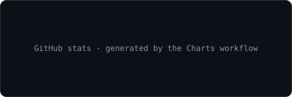
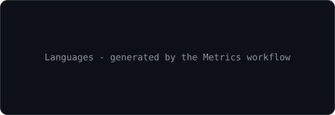

<!-- BANNER - terminal profile.sh --live (additive). Generated by scripts/banner/generate.py.
     Cache-bust with ?v=N after regenerating. -->
<picture>
  <source media="(prefers-color-scheme: dark)"  srcset="assets/banner-dark.v11.svg">
  <source media="(prefers-color-scheme: light)" srcset="assets/banner-light.v11.svg">
  
</picture>

 

<!-- NAME / TAGLINE - animated typing -->

 

&nbsp;&nbsp;

 

---

## `whoami`

### Application Engineer | Product Deployment & Release Engineering | Test Automation | CI/CD & DevOps

I'm an IT professional with experience in enterprise application support, test automation, messaging infrastructure, database technologies, and cloud platforms. I enjoy building practical engineering tools, automating repetitive workflows, and improving software quality through reliable testing and CI/CD practices.

- 🔭 **Building:** Playwright automation frameworks, Jenkins pipelines, and RabbitMQ QA utilities
- 🧪 **Test Automation:** Playwright, Python, TypeScript, Pytest, Cypress
- 🔌 **API & Performance Testing:** Postman, JMeter, API validation, SQL testing
- ⚙️ **CI/CD & DevOps:** Jenkins, Azure DevOps, Git, automated reporting
- ☁️ **Cloud Platforms:** Microsoft Azure, AWS
- 📨 **Messaging & Integration:** RabbitMQ, IBM MQ
- 🗄️ **Databases:** Microsoft SQL Server, Oracle, Redis
- 🖥️ **Infrastructure:** Linux, Windows Server, IIS, Windows Services
- 🔐 **Security:** TLS/SSL, Mutual TLS, API Security
- 📊 **Monitoring & Diagnostics:** Elastic Stack, Kibana, log analysis
- 🎯 **Professional Focus:** SDET, Test Automation Engineering, DevOps, and Automation Leadership

---

## `toolbox`

**Automation & Testing**

 

  

**CI/CD, Cloud & Source Control**

 

  

**Messaging, Databases & Infrastructure**

 

---

## `signals`

<table>
<tr>
<td width="50%" align="center" valign="middle">

<!-- Self-rated radar - edit assets/skills.json, the workflow redraws it -->
<picture>
  <source media="(prefers-color-scheme: dark)"  srcset="assets/radar-dark.svg">
  <source media="(prefers-color-scheme: light)" srcset="assets/radar-light.svg">
  
</picture>

</td>
<td width="50%" align="center" valign="middle">

<!-- Language stack radar - edit assets/langmix.json -->
<picture>
  <source media="(prefers-color-scheme: dark)"  srcset="assets/radar-langs-dark.svg">
  <source media="(prefers-color-scheme: light)" srcset="assets/radar-langs-light.svg">
  
</picture>

</td>
</tr>
</table>

---

## 🚀 Featured Projects

### 🧪 1. Playwright Automation Framework

**[Explore Repository →](https://github.com/iamgstomar/Playwright-Automation)**

A Python-based UI test automation framework built with Playwright to streamline test execution, improve test coverage, and generate actionable test reports.

**Key Features**

- Browser automation using Playwright and Python
- Pytest-based test execution
- Excel-driven test case management
- Automated test generation from test case definitions
- PASS, FAIL, BLOCKED, and SKIPPED result tracking
- Automated screenshots and test result reporting
- Allure reporting integration
- Jenkins CI/CD pipeline integration

**Tech Stack:** `Python` `Playwright` `Pytest` `Excel` `Allure` `Jenkins` `Git`

### 🐇 2. RabbitMQ QA Utility

**[Explore Repository →](https://github.com/iamgstomar/RabbitMQ-QA-Utility-Phase-One)**

A RabbitMQ administration and quality assurance utility designed to simplify messaging operations, broker monitoring, configuration management, and infrastructure troubleshooting.

**Key Features**

- Queue listing, creation, purging, and bulk deletion
- Message preview, backup, and publishing
- High-throughput message backup utilities
- Exchange and binding management
- User and permission management
- Connection and channel monitoring
- Virtual host management
- Feature flags, policies, and node information
- Plugin management, including Shovels and Federation
- RabbitMQ aliveness checks
- Message publishing through AMQP and HTTP
- TCP port scanning and connectivity diagnostics
- Definitions import and export
- User activity tracking and administrative auditing

**Tech Stack:** `RabbitMQ` `Messaging Systems` `QA Engineering` `Infrastructure Diagnostics`

### 🌐 3. RabbitMQ Web Toolkit — RMQ QA Utility

**[Explore Repository →](https://github.com/iamgstomar/RabbitMQ-Web-Toolkit)**

A browser-based RabbitMQ administration and QA toolkit built with Python, Flask, and RabbitMQ's Management HTTP API. It brings broker monitoring, queue operations, connectivity diagnostics, and activity auditing into a centralized web interface.

**Key Features**

- Broker and cluster monitoring
- Queue and exchange administration
- Message preview, backup, and restore utilities
- Connection and channel inspection
- User, permission, and virtual host management
- Policies and Shovels management
- Configurable TCP port scanning
- SQL Server-backed activity auditing
- Local JSON fallback for audit entries
- Audit filtering and CSV export

**Tech Stack:** `Python` `Flask` `RabbitMQ Management API` `SQL Server` `pyodbc` `HTML` `CSS` `JavaScript`

### 📂 Explore More Projects

Discover my other repositories, engineering utilities, and automation experiments.

**[View All Repositories →](https://github.com/iamgstomar?tab=repositories)**

---

## 🏅 Microsoft Certifications

- Microsoft Certified: Azure DevOps Engineer Expert — AZ-400
- Microsoft Certified: Azure Administrator Associate — AZ-104
- Microsoft Certified: Azure Fundamentals — AZ-900

---

## 🛠️ Technical Skills

| Category | Technologies |
|---|---|
| Test Automation | Playwright, Python, TypeScript, Pytest, Cypress |
| API & Performance Testing | Postman, JMeter, API Testing |
| Test Reporting | Allure, Pytest Reports, Excel-based Reporting |
| CI/CD & Version Control | Jenkins, Azure DevOps, Git |
| Cloud | Microsoft Azure, AWS |
| Databases | SQL Server, Oracle, Redis |
| Messaging | RabbitMQ, IBM MQ |
| Scripting | Python, PowerShell |
| Operating Systems | Linux, Windows Server |
| Application Infrastructure | IIS, Windows Services |
| Security | TLS/SSL, Mutual TLS, API Security |
| Monitoring & Troubleshooting | Elastic Stack, Kibana, Log Analysis |

---

## 📈 Current Engineering Focus

- Developing scalable, reusable Playwright automation frameworks.
- Integrating automated tests into Jenkins CI/CD pipelines.
- Improving test reporting, debugging, and failure analysis.
- Building practical QA tools for messaging infrastructure.
- Exploring AI-assisted testing and intelligent automation.
- Strengthening Azure DevOps and cloud automation capabilities.

---

## `numbers`

<!-- Generated by scripts/cards.py into this repo (Charts and cards workflow). -->
<picture>
  <source media="(prefers-color-scheme: dark)"  srcset="assets/card-stats-dark.svg">
  <source media="(prefers-color-scheme: light)" srcset="assets/card-stats-light.svg">
  
</picture>

 

---

## 🤝 Connect With Me

* 📧 Email: [gajendra@gmail.com](mailto:gajendra@gmail.com)
* 💼 LinkedIn: [Gajendra Tomar](https://www.linkedin.com/in/gajera-tar-3672/)
* 🐙 GitHub: [@iamgstomar](https://github.com/iamgstomar)

---

  

Automating quality. Simplifying operations. Building reliable engineering solutions.

